# AWS Cloud Project: VPC Infrastructure Troubleshooting & Traffic Analysis

## Executive Summary

Project ini mendokumentasikan proses investigasi, perbaikan masalah konektivitas jaringan (root-cause analysis), serta analisis traffic log pada infrastruktur Virtual Private Cloud (VPC) di Amazon Web Services (AWS). 

Investigasi dilakukan secara penuh menggunakan AWS CLI dan utilitas Linux Terminal untuk mengidentifikasi miskonfigurasi pada Route Table dan Network Access Control List (NACL), serta memverifikasi denied traffic menggunakan VPC Flow Logs yang disimpan di Amazon S3.

---

## Project Overview & Technical Matrix

| Parameter | Detail Spesifikasi |
| :--- | :--- |
| **Cloud Provider** | Amazon Web Services (AWS) |
| **Layanan Utama** | AWS VPC, EC2, S3, VPC Flow Logs, Internet Gateway, Route Table, NACL, Security Group |
| **Tools & CLI** | AWS CLI v2, Linux Bash, nmap, grep, gunzip |
| **Fokus Keahlian** | Cloud Networking, Security Analysis, Incident Response, Log Analysis |

---

## Architecture & Scenario Setup
| 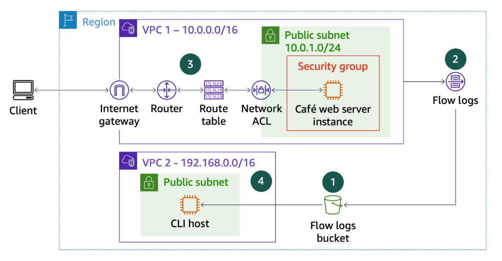 |
| Skenario | Deskripsi Masalah |
| :--- | :--- |
| **Masalah 1 (Akses Web HTTP)** | Instance Cafe Web Server di public subnet tidak dapat diakses melalui web browser (Connection Timed Out). |
| **Masalah 2 (Akses SSH)** | EC2 Instance Connect gagal melakukan koneksi SSH ke Web Server. |
| **Analisis Audit** | Membuat dan menganalisis log lalu lintas jaringan untuk mengidentifikasi paket yang ditolak (REJECT). |

---

## Technical Implementation & Troubleshooting Steps

### Phase 1: Inisialisasi VPC Flow Logs ke Amazon S3

Membuat S3 Bucket sebagai repositori log dan mengaktifkan registrasi VPC Flow Logs pada VPC1.

```bash
# 1. Membuat S3 Bucket
aws s3api create-bucket --bucket flowlog-vpc-lab-01 --region us-west-2 --create-bucket-configuration LocationConstraint=us-west-2

# 2. Mendapatkan VPC ID
aws ec2 describe-vpcs --query 'Vpcs[*].[VpcId,Tags[?Key==`Name`].Value,CidrBlock]' --filters "Name=tag:Name,Values='VPC1'"

# 3. Mengaktifkan Flow Logs
aws ec2 create-flow-logs --resource-type VPC --resource-ids vpc-xxxxxxxxxxxxxxxxx --traffic-type ALL --log-destination-type s3 --log-destination arn:aws:s3:::flowlog-vpc-lab-01

# 4. Verifikasi status Flow Logs
aws ec2 describe-flow-logs
```

| Dokumentasi Flow Log Setup |
| :--- |
| 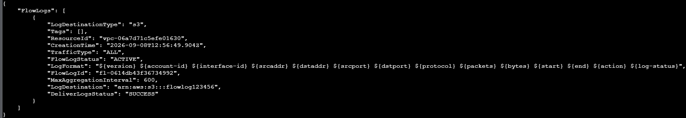 |
| *Gambar 1: Output status VPC Flow Logs menunjukkan status ACTIVE dan mengarah ke S3 Bucket.* |

---

### Phase 2: Troubleshooting Akses Web Server (HTTP Port 80)

#### 1. Identifikasi & Root Cause Analysis
* **Gejala:** Aplikasi Web HTTP mengalami timeout.
* **Hasil Scan Port:** `nmap <WebServerIP>` menunjukkan tidak ada port terbuka dari luar.
* **Pemeriksaan Security Group:** Diizinkan untuk Port 80 dan 22.
* **Akar Masalah:** Route Table pada Subnet Publik tempat Web Server berada tidak memiliki rute default (`0.0.0.0/0`) menuju Internet Gateway (IGW).

| Bukti Error & Investigasi Awal |
| :--- |
| 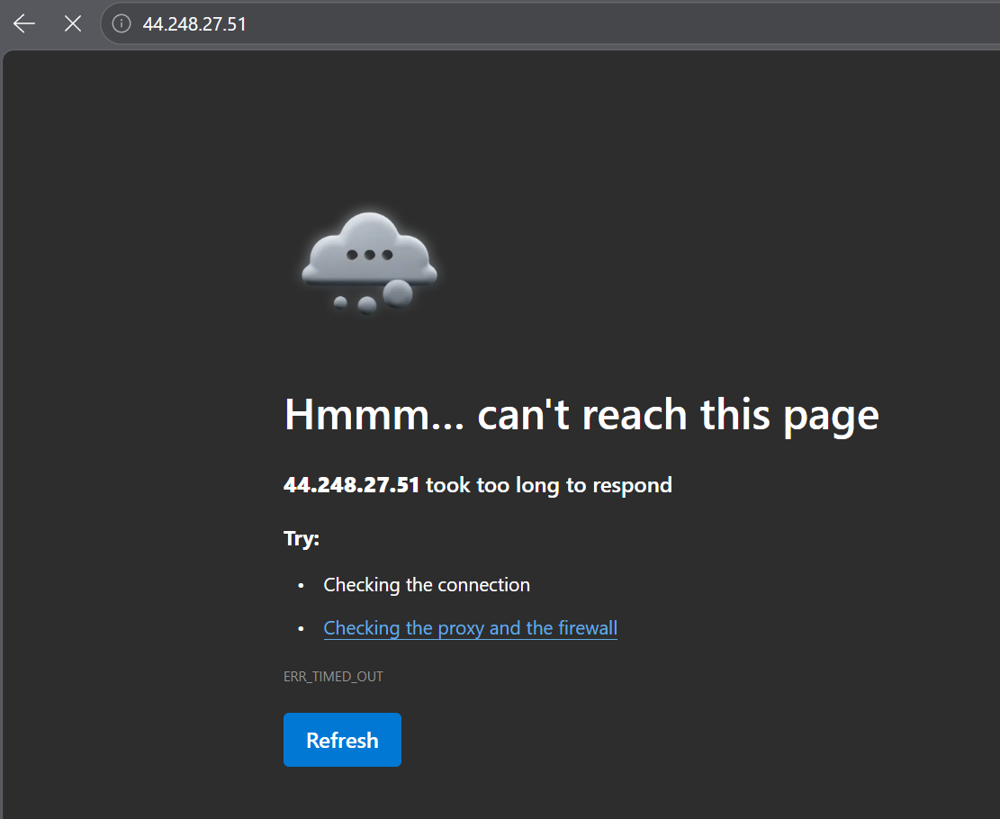 |
| *Gambar 2: Kegagalan akses web server melalui HTTP browser.* |

#### 2. Tindakan Perbaikan (Remediation)
Menambahkan rute baru pada Route Table Subnet Publik menuju Internet Gateway.

```bash
# Menambahkan rute default 0.0.0.0/0 ke Internet Gateway
aws ec2 create-route \
    --route-table-id rtb-xxxxxxxxxxxxxxxxx \
    --gateway-id igw-xxxxxxxxxxxxxxxxx \
    --destination-cidr-block '0.0.0.0/0'
```

| Eksekusi Perbaikan & Bukti Keberhasilan HTTP |
| :--- |
| 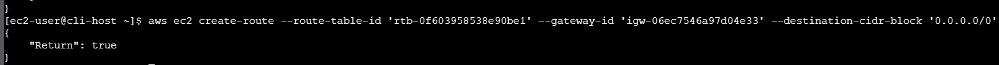 |
| *Gambar 3: Perintah AWS CLI untuk menambahkan rute ke Internet Gateway.* |
| 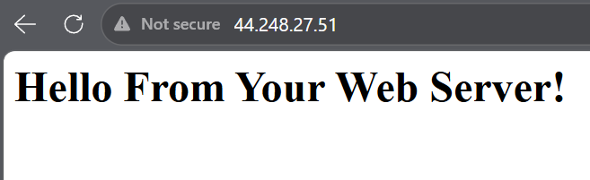 |
| *Gambar 4: Web Server berhasil diakses melalui HTTP ("Hello From Your Web Server!").* |

---

### Phase 3: Troubleshooting Akses Remote SSH (Port 22)

#### 1. Identifikasi & Root Cause Analysis
* **Gejala:** EC2 Instance Connect gagal terhubung ke instance.
* **Pemeriksaan Route Table & Security Group:** Sudah terkonfigurasi dengan benar.
* **Akar Masalah:** Terdapat aturan Inbound Rule #40 DENY pada Network ACL (NACL) subnet yang secara eksplisit memblokir trafik ke port SSH.

| Bukti Error SSH / EC2 Instance Connect |
| :--- |
| 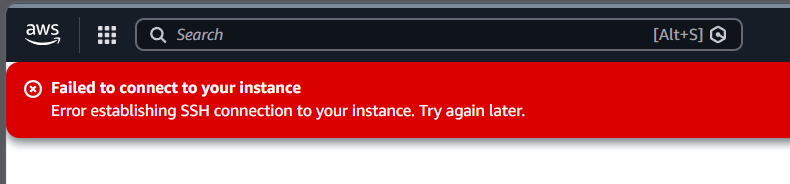 |
| *Gambar 5: EC2 Instance Connect gagal terhubung ke Web Server.* |

#### 2. Tindakan Perbaikan (Remediation)
Menghapus aturan NACL nomor 40 yang memblokir lalu lintas ingress.

```bash
# Menghapus aturan DENY pada Network ACL
aws ec2 delete-network-acl-entry \
    --network-acl-id acl-xxxxxxxxxxxxxxxxx \
    --ingress \
    --rule-number 40
```

| Eksekusi Perbaikan & Bukti Keberhasilan SSH |
| :--- |
| 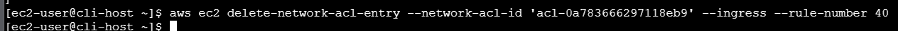 |
| *Gambar 6: Perintah AWS CLI penghapusan rule Network ACL nomor 40.* |
| 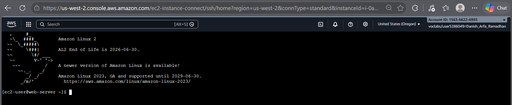 |
| *Gambar 7: Berhasil masuk ke Web Server via EC2 Instance Connect dan konfirmasi hostname.* |

---

### Phase 4: Analisis Trafik & Audit Menggunakan VPC Flow Logs

Mengunduh, mengekstrak, dan melakukan kueri log dari Amazon S3 untuk memverifikasi penolakan koneksi SSH (REJECT) berdasarkan IP sumber lokal.

#### 1. Mengunduh & Mengurai Log File

```bash
# Download log dari S3 Bucket
mkdir flowlogs && cd flowlogs
aws s3 cp s3://flowlog-vpc-lab-01/ . --recursive

# Pindah ke direktori log dan ekstrak file log
cd AWSLogs/<AccountID>/vpcflowlogs/us-west-2/2026/09/08/
gunzip *.gz
```

| Bukti File Log Terunduh & Diekstrak |
| :--- |
| 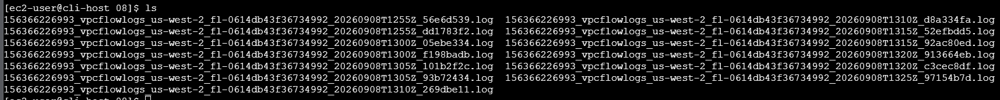 |
| *Gambar 8: File log dari S3 berhasil di-unzip untuk dianalisis.* |

#### 2. Filtering Log Ditolak (REJECT Entry Analysis)
Filter log untuk mengisolasi penolakan paket pada Port 22 yang berasal dari IP Publik komputer penguji.

```bash
# 1. Menghitung total rekaman REJECT pada log
grep -rn REJECT . | wc -l

# 2. Filtering spesifik: Port 22 + REJECT + Public IP Penguji
grep -rn 22 . | grep REJECT | grep <Your-Public-IP>

# 3. Menerjemahkan Unix Timestamp ke format waktu lokal
date -d @1757365188
```

| Bukti Analisis Log REJECT |
| :--- |
| 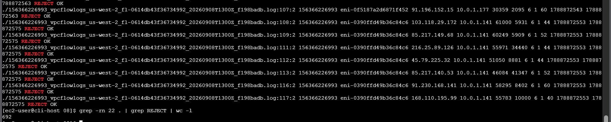 |
| *Gambar 9: Log VPC memperlihatkan rincian trafik Port 22 REJECT beserta ENI ID terkait.* |
| 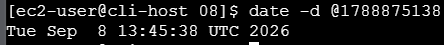 |
| *Gambar 10: Konversi Unix Timestamp menjadi waktu lokal nyata yang sesuai dengan kejadian insiden.* |

---

## Verification & Key Takeaways

| Komponen Jaringan | Status Awal | Status Akhir | Penyebab Utama |
| :--- | :--- | :--- | :--- |
| **HTTP Access (Port 80)** | Failed | OK (200) | Missing Default Route (`0.0.0.0/0`) to Internet Gateway |
| **SSH Access (Port 22)** | Failed | Connected | Explicit DENY Ingress Rule (#40) in Network ACL |
| **VPC Flow Logging** | Inactive | Active / Verified | Capturing & Auditing Network Packets to S3 Bucket |

| Core Competencies Validated |
| :--- |
| **Cloud Infrastructure Troubleshooting:** Kemampuan melakukan isolasi masalah bertahap (Layer 3/4 Networking). |
| **Security & Access Control:** Pemahaman mendalam terkait perbedaan sifat Stateful (Security Groups) vs Stateless (Network ACLs). |
| **Log Forensics:** Keahlian ekstraksi dan analisis raw traffic log menggunakan CLI/Bash scripting pada AWS. |
